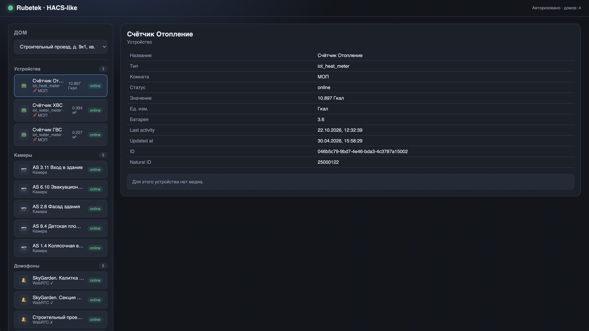
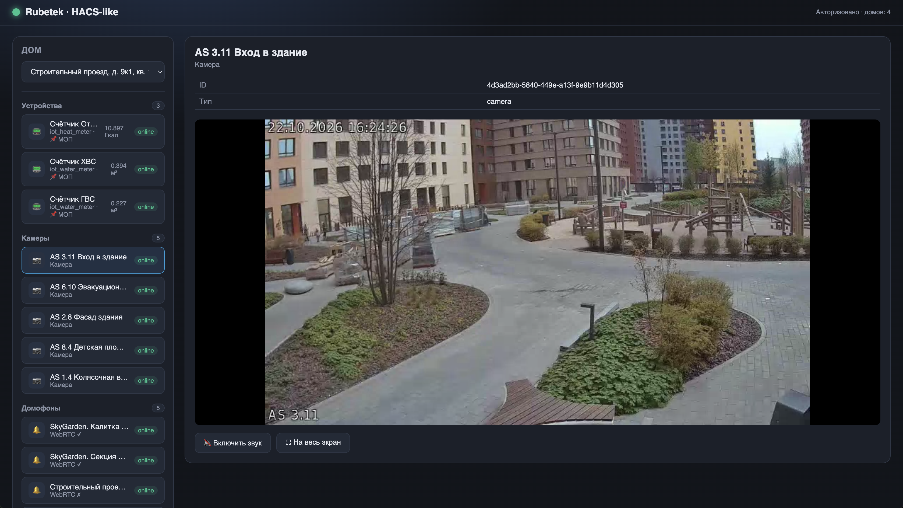
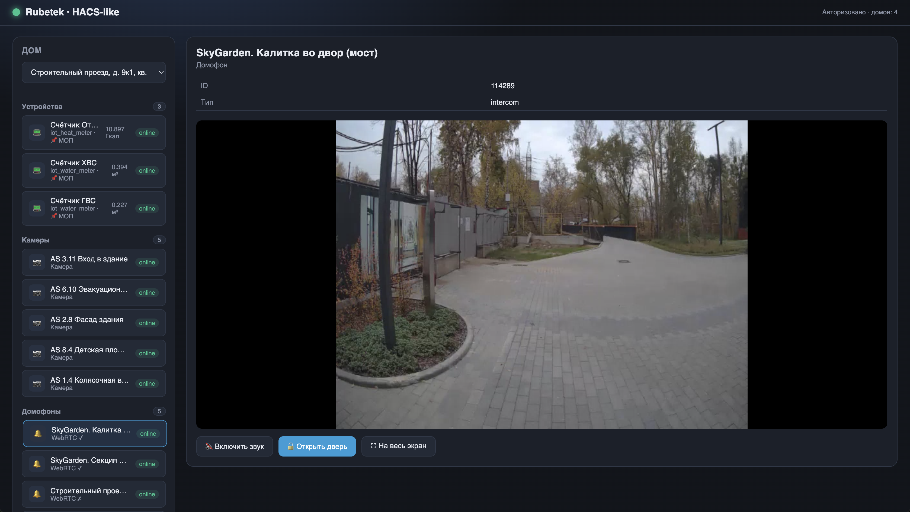

# Rubetek API Library

[](https://www.python.org)
[](LICENSE)
[](https://hacs.xyz)

> Асинхронная Python-библиотека для работы с облачной платформой умного дома **Rubetek**.

## 📋 Описание

Библиотека предоставляет удобный асинхронный интерфейс для подключения к облачной платформе
Rubetek: управление сессией, получение данных об устройствах, камерах и домофонах,
а также мониторинг состояния всей экосистемы. Основана на
[RubetekSocketApi](https://github.com/regenara/rubetek_socket_api).

> **Внимание:** проект является сторонней, неофициальной библиотекой и **не имеет отношения
> к компании Rubetek** — это независимая реализация под клиентский API.

## ✨ Возможности

- 🔐 Авторизация и управление сессией подключения к Rubetek Cloud
- 🏠 Получение списка домов (homes) и устройств с текущим состоянием
- 🎥 Работа с камерами: статус, live-снимок, доступ к RTSP-потоку
- 🏢 Домофоны (intercoms): статус и поддержка WebRTC
- 📺 Просмотр видеопотока домофона через **WebRTC** (`WebRTCViewer`)
- 🔔 Подписка на события в реальном времени (WebSocket)
- 🔄 Автоматическое переподключение и обновление токенов при обрыве связи
- 🪵 Логирование с маскированием чувствительных данных и настраиваемым уровнем детализации

## 🖼️ Интерфейс

Интерфейс HACS-подобной панели (`Examples/test_portal.py`):

| Устройства | Камеры | Домофоны |
|:---:|:---:|:---:|
|  |  |  |

## 🚀 Установка

### Базовый пакет

```bash
pip install saarubetek-api
```

> Установка из исходников:

```bash
pip install git+https://github.com/RuFiHome/RubetekAPI.git
```

### Дополнительные зависимости (по функционалу)

WebRTC-видео требует `aiortc` и `websockets`:

```bash
pip install "saarubetek-api[webrtc]"
```

## 🧑‍💻 Быстрый старт

```python
import asyncio
from SAARubetekAPI import SAARubetekAPI
from SAARubetekAPI.exceptions import AuthorizationRequiredRubetekAPIError

async def main():
    api = SAARubetekAPI()
    try:
        try:
            await api.refresh_tokens()
        except AuthorizationRequiredRubetekAPIError as error:
            print(error)
            phone = input("Введите номер телефона (c +7): ")
            await api.authentication(phone=phone)
            code = input("Введите последние 4 цифры номера звонившего телефона: ")
            await api.authorization(phone=phone, code=code)

        user = await api.get_user()
        print("User:", user)

        houses = await api.get_homes()
        api.house_id = houses[0].id if houses else None
        print("Homes:", houses)

        devices = await api.get_devices()
        print("Devices:", devices)

        cameras = await api.get_cameras()
        print("Cameras:", cameras)

        intercoms = await api.get_intercoms()
        print("Intercoms:", intercoms)
    finally:
        await api.close()

if __name__ == "__main__":
    asyncio.run(main())
```

Полный пример с просмотром WebRTC-потока домофона — в [`Examples/run.py`](Examples/run.py).

## 📁 Структура проекта

- `SAARubetekAPI/` — исходный код библиотеки
  - `wrapper.py` — основной клиент `SAARubetekAPI`
  - `models.py` — Pydantic-модели (User, House, Device, Camera, Intercom)
  - `webrtc.py` — просмотр WebRTC-видео домофона (`WebRTCViewer`)
  - `exceptions.py` — иерархия ошибок библиотеки
  - `logger.py` — логирование с маскированием токенов/телефонов
- `Examples/` — примеры использования

## ⚖️ Лицензия

[MIT](LICENSE)